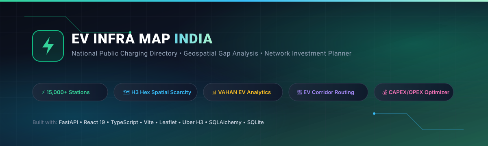
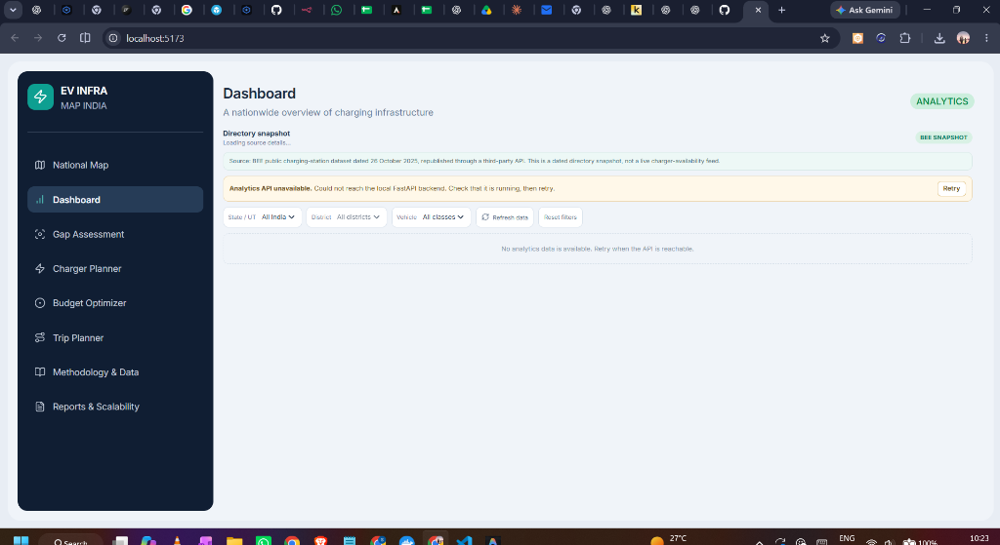
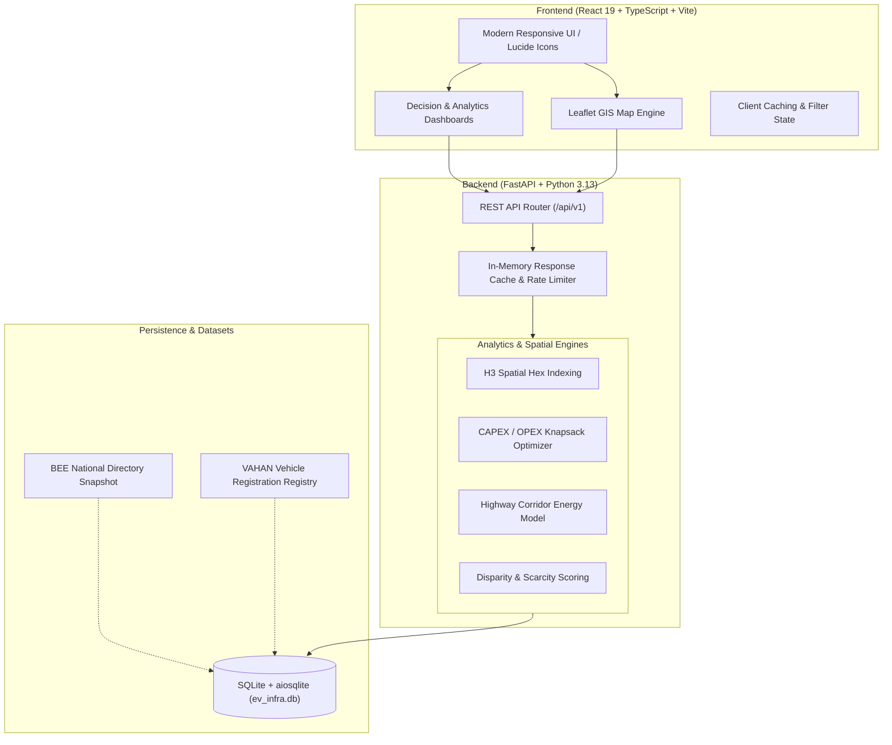

<div align="center">



<br/>
<br/>

[](https://fastapi.tiangolo.com)
[](https://react.dev)
[](https://www.typescriptlang.org)
[](https://vitejs.dev)
[](https://leafletjs.com)
[](https://h3geo.org/)
[](https://python.org)

<p align="center">
  <strong>India's Next-Generation Public EV Charging Intelligence, Geospatial Gap Analysis & Infrastructure Planning Platform</strong>
</p>

<p align="center">
  <a href="#-key-features">Key Features</a> •
  <a href="#-dashboard-preview">Preview</a> •
  <a href="#-system-architecture">Architecture</a> •
  <a href="#-quick-start">Quick Start</a> •
  <a href="#-api-endpoints">API Reference</a> •
  <a href="#-data-sources">Data Scope</a>
</p>

</div>

---

## ⚡ Overview

**EV Infra Map India** is a full-stack geospatial intelligence and scenario-planning platform tailored to India's electric mobility transition. It unites verified public charging directories, VAHAN vehicle registration registries, and spatial clustering algorithms into an interactive, high-performance web dashboard.

Whether evaluating urban charger deficits, planning intercity highway corridors, or optimizing multi-crore CAPEX investments, this platform equips policymakers, CPOs (Charge Point Operators), and EV drivers with transparent, data-driven decisions.

---

## 📸 Dashboard Preview

<div align="center">
  
  <p><em>Real-time Decision Dashboard displaying national charging metrics, connector distribution, and regional analysis.</em></p>
</div>

---

## 🚀 Key Features

<table>
  <tr>
    <td width="50%">
      <h3>🗺️ National Charging Map</h3>
      Interactive Leaflet GIS map visualizing public charging stations across all Indian states and Union Territories. Features spatial clustering, fast/slow charger filtering, and operator-specific layers.
    </td>
    <td width="50%">
      <h3>📊 Decision Dashboard</h3>
      Executive overview with automated station totals, state distribution, connector-type breakdowns (CCS-2, CHAdeMO, Type-2 AC, Bharat DC-001), and power capacity metrics.
    </td>
  </tr>
  <tr>
    <td width="50%">
      <h3>🔍 Spatial Gap Assessment</h3>
      Powered by <strong>Uber H3 hexagonal indexing</strong>. Pinpoints underserved districts, calculates charger-to-EV disparity ratios, and identifies charging deserts.
    </td>
    <td width="50%">
      <h3>⚡ Charger Rollout Planner</h3>
      Estimates future charging equipment requirements using customizable EV adoption scenarios, peak-hour concurrency factors, and regional target ratios.
    </td>
  </tr>
  <tr>
    <td width="50%">
      <h3>💰 Budget Optimizer</h3>
      Algorithmic linear knapsack investment ranking. Evaluates district opportunity packages and recommends optimal site allocations within specified CAPEX / OPEX ceilings.
    </td>
    <td width="50%">
      <h3>🛣️ Highway Corridor Trip Planner</h3>
      Simulates long-distance EV journeys along prominent Indian national highway corridors. Estimates battery discharge curves and recommends strategic charging stops.
    </td>
  </tr>
</table>

---

## 🏗️ System Architecture



---

## 📂 Project Structure

```text
EV-infra-main/
├── backend/                  # FastAPI Application
│   ├── app/
│   │   ├── data/             # BEE & VAHAN source dataset snapshots
│   │   ├── db/               # SQLAlchemy models, SQLite async session & ingest
│   │   ├── models/           # Pydantic schemas (analytics, planning, trip)
│   │   ├── services/         # Budget optimizer, H3 analytics, trip planner
│   │   └── main.py           # FastAPI endpoints, CORS, and middleware
│   ├── ev_infra.db           # Bundled pre-indexed SQLite database
│   └── requirements.txt      # Python dependencies
├── frontend/                 # Vite + React + TypeScript App
│   ├── src/
│   │   ├── components/       # Map, Dashboard, Gap Assessment, Planners
│   │   ├── services/         # API client & data fetchers
│   │   ├── types/            # TypeScript domain interfaces
│   │   └── styles.css        # Clean dark-mode stylesheet
│   └── package.json          # Node dependencies & build scripts
├── database/                 # Schema and migrations foundation
├── docs/images/              # Visual assets, banners & UI screenshots
├── run-backend.bat           # 1-click backend launcher (Windows)
├── run-frontend.bat          # 1-click frontend launcher (Windows)
└── start-all.bat             # 1-click launch all services
```

---

## 🛠️ Quick Start

### Prerequisites
- **Python 3.11+** (Python 3.13 recommended)
- **Node.js 18+** & **npm**

---

### Option A: 1-Click Launch (Windows)

Simply double-click:
```powershell
start-all.bat
```
This automatically boots both the FastAPI backend and the Vite frontend dev server in separate windows.

---

### Option B: Manual Setup

#### 1. Backend Service
```powershell
# Navigate to backend directory
cd backend

# Create and activate virtual environment
python -m venv .venv
.\.venv\Scripts\Activate.ps1    # On Linux/macOS: source .venv/bin/activate

# Install dependencies
pip install -r requirements.txt

# Start FastAPI server
python -m uvicorn app.main:app --reload --host 127.0.0.1 --port 8000
```
> 🩺 **Health Check:** [http://127.0.0.1:8000/health](http://127.0.0.1:8000/health)  
> 📖 **Interactive Swagger Docs:** [http://127.0.0.1:8000/docs](http://127.0.0.1:8000/docs)

#### 2. Frontend Application
```powershell
# Navigate to frontend directory
cd ../frontend

# Install dependencies
npm install

# Start Vite development server
npm run dev
```
> 🌐 **Web App:** [http://localhost:5173](http://localhost:5173)

---

## 🔌 API Endpoints

| Method | Endpoint | Description |
| :--- | :--- | :--- |
| `GET` | `/health` | Service health status and database connectivity |
| `GET` | `/api/v1/chargers` | Paginated public charging station directory with filters |
| `GET` | `/api/v1/states` | List of states and Union Territories with station counts |
| `GET` | `/api/v1/districts` | District-level charger counts and metadata |
| `GET` | `/api/v1/analytics/summary` | Aggregated national & filtered charging statistics |
| `POST` | `/api/v1/analytics/gap-assessment` | Calculates district-level infrastructure scarcity index |
| `POST` | `/api/v1/requirements` | Estimates regional charger demand from EV growth projections |
| `POST` | `/api/v1/optimize` | Solves budget allocation to maximize infrastructure impact |
| `GET` | `/api/v1/trip/corridors` | Lists supported major highway corridors |
| `POST` | `/api/v1/trip/plan` | Journey energy consumption model & charger stop recommender |

---

## 📊 Data Sources & Disclaimers

- **BEE Charging Station Directory:** Derived from the Bureau of Energy Efficiency (BEE) public charging station directory snapshot (dated 26 October 2025). This dataset serves as a directory baseline and does not represent real-time plug occupancy.
- **VAHAN Registrations:** Aggregated statistical vehicle population distribution based on Ministry of Road Transport and Highways (MoRTH) public filings.
- **Planning Scenarios:** Budget optimization and trip simulation tools operate on reproducible mathematical models for illustrative infrastructure scenario evaluation.

---

## 📄 License

This project is open-source and built for research, policy planning, and hackathon demonstration. Feel free to fork and build upon it!
